# ui-patterns-alloy

[pebble-examples/ui-patterns](https://github.com/pebble-examples/ui-patterns)
recreated one-to-one in Alloy (JavaScript on the watch, Piu UI). Run the app,
then choose a menu option to see one of the recommended Pebble UI patterns:
checkbox list, choice dialog, message dialog, list with a hint, radio button
list, PIN entry, text animation, progress bar, progress layer, app config
prompt.

Emery (Pebble Time 2) and gabbro (Pebble Round 2), the platforms Alloy runs on.

| Pattern | Emery (Pebble Time 2) | Gabbro (Pebble Round 2) |
| --- | --- | --- |
| Main menu | 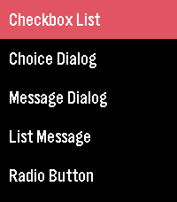 | 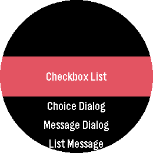 |
| Checkbox list | 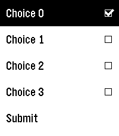 | 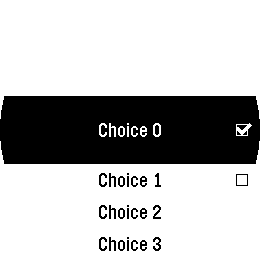 |
| Radio button list | 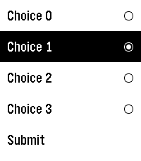 | 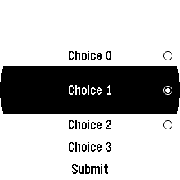 |
| Message dialog | 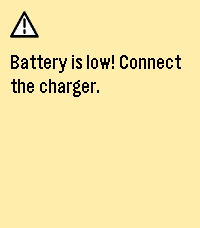 | 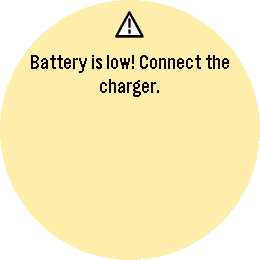 |
| Choice dialog | 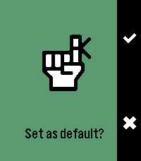 | 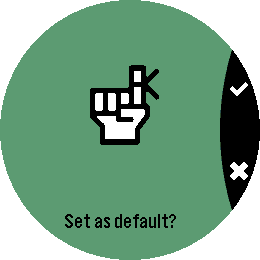 |
| List hint message | 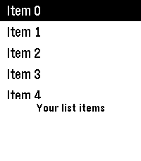 | 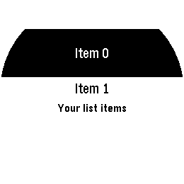 |
| PIN entry | 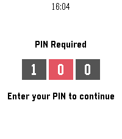 | 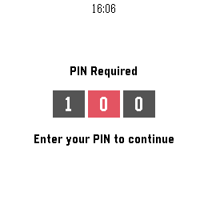 |
| Text animation | 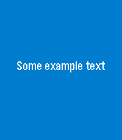 | 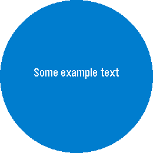 |
| Progress bar | 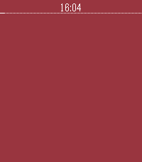 | 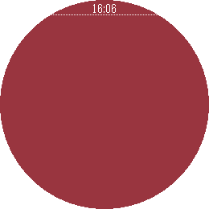 |
| Progress layer | 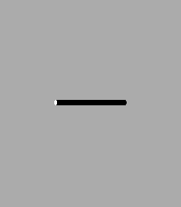 | 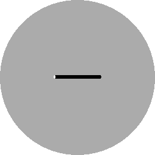 |
| Config dialog window | 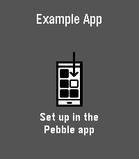 | 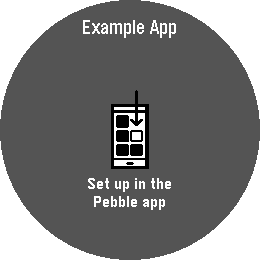 |

All frames at once: [emery](screenshots/emery/all.png), [gabbro](screenshots/gabbro/all.png).

## One-to-one, verified

The C original was built for emery and gabbro with SDK 4.33.1, driven through
every screen in the emulators, and screenshotted. This app was put through the
same steps and the PNGs diffed pixel by pixel. The menus, the checkbox and
radio lists, the message dialog, the list with its hint and the text
animation are identical on emery, pixel for pixel; on gabbro the same, except
a handful of blended pixels along the round action bar's anti-aliased edge.
The five screens below differ from the C app only where it was adapted
(`screenshots/` holds this app's frames). The behaviours match the C code:
Up/Down with repeat while held, Select and Back per window, the checkbox and
radio submit logs, the PIN callback (`Pin was 2 9 0`), the timers and
animations with the C durations.

Geometry that the C SDK computes internally was measured on the emulators,
not guessed: MenuLayer cells and scrolling, the action bar and its icon
positions, the status bar, the fonts the firmware substitutes on these
displays. Each measured value is named where it is used.

### Adapted for the larger screens

The C windows hard-code a few positions for the original 144x168 screen; built
as-is for emery or gabbro they put text over the icons and cells. Here those
positions are anchored to what they sit next to, so the screens look as the
original does:

| Window | C constant | Here |
| --- | --- | --- |
| Choice dialog | label `top: 112` | the bottom 56 px, the band the icon is inset by |
| App config prompt | body `top: 125` | 2 px under the centred icon |
| PIN entry | title `top: 30`, sub text `top: 115` | 37 px above and 14 px below the centred cells |
| Progress bar | width `144` | the screen's width (the C comment: "system default") |
| Progress layer | `top: 80` | 4 px above the middle |

The list hint keeps the C position (top 140 over a 150 px menu): the original
covers the last row the same way.

## Layout

```
src/c/mdbl.c                       the JavaScript machine (heap sizes below)
src/embeddedjs/main.js             the application and its controller
src/embeddedjs/assets.js           SDK defines, resource IDs, colours, fonts
src/embeddedjs/modules/
  piuController.js                 the window stack: goTo / goBack with slide transitions
  piuView.js                       the View base class (a window) and the transition
  Menu.js                          MenuLayer: cells, highlight, scrolling, round cells
  StatusBar.js                     StatusBarLayer, with the dotted separator
src/embeddedjs/layers/
  progress_layer.js                ProgressLayer
  selection_layer.js               SelectionLayer (the PIN cells, bump and slide animations)
src/embeddedjs/windows/            one module per C window, same names
resources/images/                  the C project's bitmaps, same resource order
screenshots/{emery,gabbro}/        this app in the emulators
```

Each window module exports a View subclass: its `Template` builds the screen,
its `Behavior` handles the buttons. The main menu opens a window with
`controller.goTo("<module>")`; Back pops it, and on the main menu Back is left
unhandled so the firmware closes the app, as the C app does.

## Building and running

```sh
pebble build
pebble install --emulator emery          # or gabbro
pebble install --emulator emery --logs   # console.log lines show as xsHost.c
pebble screenshot --no-open --emulator emery out.png
pebble emu-button --emulator emery click down   # back, up, select, down
pebble install --phone <ip>
```

## Memory

The JavaScript machine runs with `stack 5120, slot 45056, chunk 21504`
(`src/c/mdbl.c`, mirrored in `src/embeddedjs/manifest.json`). The template's
default 32 kB machine aborts at launch with `memory full`, and a 43008 slot
ran out after all ten windows had been visited (each imported module stays
resident). In the emulator the compiled JavaScript (`build/mods/emery/mc.xsa`,
41.8 kB) is copied into the app heap as well: with a 23552 chunk the launch
failed with `fxMapArchive failed`, so the chunk gave 2 kB to the slot heap.
Bitmaps are loaded per window instance, not per module, so only the open
windows' GBitmaps are in the heap.

## Piu on Pebble, as found here

- A template called as a property (`$.Item(...)`) takes `$` as its `this`;
  call it with `new`.
- `Port.onDraw(port, x, y, w, h)` receives the area to redraw; the port's own
  size is `port.width` and `port.height`.
- `Port.drawString` draws from the given point whatever the style's alignment
  and margins say; centre with `style.measure(text).width`.
- Piu draws a Pebble font (cap offset − 1) px above where `graphics_draw_text`
  puts it for the same y. `TEXT_TOP_INSET` in `assets.js` holds the measured
  top margins (4 for Gothic 14, 14 Bold and 24 Bold; 2 for 18 and 18 Bold;
  5 for 28 Bold) that put the glyphs where a TextLayer has them.
- `distribute()` reaches the children before the container, so a view that
  focuses itself in `onDisplayed` takes the buttons away from its menu; such
  views focus the menu instead.
- On emery and gabbro the firmware's TextLayer default font is Gothic 18 Bold
  and the status bar's is Gothic 18 (the SDK's Gothic 14 scaled for the
  display), `ACTION_BAR_WIDTH` is 34 and 40, `STATUS_BAR_LAYER_HEIGHT` is 20.
- MenuLayer on a rectangular display centres the selected cell once it passes
  the middle, and scrolls up to 20 px past the last cell; on round the selected
  cell is 68 px and the others 32 px, always centred, titles centred.
- `graphics_draw_circle` and `graphics_fill_circle` are anti-aliased on these
  displays; the radio buttons use their coverage tables, sampled from the C app.
- A RoundRect of width 0 still paints two pixels.
